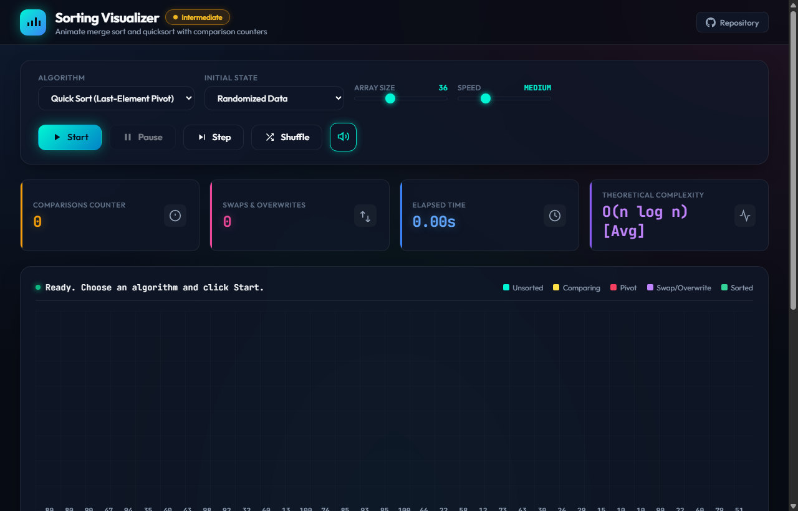

# ⚡ AlgoScope // Interactive Divide & Conquer Sorting Visualizer

<div align="center">


<br/>

**A high-performance, audio-visual algorithm simulator engineered to demonstrate divide-and-conquer mechanics, comparison overhead, and asymptotic complexity boundaries in real-time.**

<br/>



</div>

---

## 🚀 Key Highlights & Architectural Features

### 🎨 1. Cyberpunk Glassmorphism UI & 60 FPS Visuals
* **Hardware-Accelerated Animations:** Rendered with CSS `transform` and `flexbox` transitions running at butter-smooth 60 frames per second without frame drops.
* **Smart Dynamic Color Coding:**
  * 🩵 **Unsorted Bars:** Sleek cyan-to-azure gradient with subtle neon aura.
  * 💛 **Active Comparison:** Glowing high-intensity amber (`#ffd166`) with upward elevation.
  * 🔴 **Pivot Element:** Hot neon crimson with a dedicated floating `PIVOT` indicator badge.
  * 💜 **Swap / Overwrite:** Electric violet burst with depth pulses.
  * 💚 **Sorted / Victory Sweep:** Shimmering emerald green wave cascade on completion.

### ⚡ 2. Real-Time Empirical Metric HUD
* **Comparison Counter:** Accurately tallies every single comparison operation executed by the algorithm.
* **Swaps / Overwrites Counter:** Monitors array mutations and auxiliary memory transfers.
* **Stopwatch Timer:** High-precision elapsed time tracker using `performance.now()`.
* **Dynamic Complexity Monitor:** Automatically flags the current theoretical complexity (e.g., transitions to $O(n^2)$ when Quick Sort runs on reversed data).

### 🔊 3. Interactive Web Audio Synthesizer
* Native integration with the **Web Audio API** (zero external dependencies).
* Maps each array element's value to a corresponding audible frequency ($160\text{ Hz} \to 950\text{ Hz}$).
* Generates distinctive acoustic feedback for comparisons, swaps, and an arpeggio victory chord upon completion (with a one-click mute toggle).

### 🎛️ 4. Full Execution Engine & State Machine
* **Generator-Based Control:** Built with JavaScript ES6 `function*` generators, eliminating fragile async timeout loops.
* **Interactive Step Mode (`Step`):** Allows students and educators to advance the algorithm one comparison/swap at a time for deep analysis.
* **Live Speed & Size Sliders:** Adjust visualization speed from slow-motion teaching mode up to turbo speed, and scale arrays from 10 to 80 elements dynamically.
* **Dataset Presets:** Instantly toggle between **Randomized**, **Reverse-Sorted**, **Already Sorted**, and **Nearly Sorted** distributions.

---

## 📊 Divide & Conquer Empirical Analysis

This project directly demonstrates the theoretical and practical behaviors of **Merge Sort** and **Quick Sort** (Lomuto partition with last-element pivot):

| Algorithm | Best Case | Average Case | Worst Case | Auxiliary Space | Stable? | Primary Mechanism |
| :--- | :---: | :---: | :---: | :---: | :---: | :---: |
| **Merge Sort** | $\Omega(n \log n)$ | $\Theta(n \log n)$ | $O(n \log n)$ | $O(n)$ | **Yes** | Divide in half, merge sorted subarrays |
| **Quick Sort (Last Pivot)** | $\Omega(n \log n)$ | $\Theta(n \log n)$ | $\mathbf{O(n^2)}$ | $O(\log n)$ | **No** | In-place partition around $arr[\text{high}]$ |
| **Quick Sort (Random Pivot)** | $\Omega(n \log n)$ | $\Theta(n \log n)$ | $O(n \log n)^*$ | $O(\log n)$ | **No** | Randomized pivot avoids pathological inputs |

*\*Expected worst case probability is negligibly small ($O(1/n!)$).*

---

### ⚠️ The $O(n^2)$ Last-Element Pivot Trap

A central objective of this project is demonstrating the severe vulnerability of choosing the **last element** as the pivot ($arr[high]$):

1. **Random Input:** The pivot splits the array into reasonably balanced partitions, achieving optimal $\Theta(n \log n)$ recurrence:
   $$T(n) = 2T(n/2) + \Theta(n) \implies O(n \log n)$$
2. **Reverse-Sorted / Already-Sorted Input:** 
   When the array is sorted or reversed, the last element is perpetually the absolute extreme (minimum or maximum). The partition step degenerates into subsets of sizes $0$ and $n - 1$:
   $$T(n) = T(n - 1) + \Theta(n)$$
   Expanding the recurrence yields:
   $$\sum_{i=1}^{n-1} i = \frac{n(n - 1)}{2} = \mathbf{O(n^2)}$$

> **Try it in the app:** Select **Quick Sort (Last-Element Pivot)** and set the distribution to **Reverse Sorted**. Observe how the comparison counter soars to nearly $\frac{n(n-1)}{2}$ operations. Then switch to **Quick Sort (Random Pivot)** to see the partition balance restored immediately!

---

## 🗂️ Project Structure

```text
Project_2/
├── assets/
│   └── preview.png          # High-resolution screenshot of the application
├── index.html               # Semantic HTML5 layout, HUD counters & controls
├── style.css                # Modern Cyberpunk theme, glassmorphism & bar animations
├── audio.js                 # Web Audio API sound synthesis engine
├── algorithms.js            # Generator-based implementations (Merge, Quick, Random Quick)
├── app.js                   # Application state manager & DOM manipulation pipeline
└── README.md                # Project documentation & complexity analysis
```

---

## 💻 How to Run Locally

This project is built purely with **Vanilla Web Technologies** and requires **zero build tools, no `npm install`, and no local server**.

### Quick Start:
1. Clone this repository:
   ```bash
   git clone https://github.com/YousefEl-Basuony/Algorithm_Project.git
   cd Algorithm_Project/Project_2
   ```
2. Open `index.html` directly in any modern web browser (Chrome, Edge, Firefox, Safari):
   * **Windows:** Double-click `index.html` or run:
     ```powershell
     Start-Process index.html
     ```
   * **Mac / Linux:**
     ```bash
     open index.html # Mac
     xdg-open index.html # Linux
     ```

---

## 🎓 Educational Purpose & Credits

Developed as part of the **Divide & Conquer Empirical Analysis (Project 2)** study, fulfilling all assignment requirements:
* ✅ Full visualization of **Merge Sort** and **Quick Sort**.
* ✅ Real-time digital **Comparison Counters** and **Swap Counters**.
* ✅ Responsive, interactive UI with sound synthesis and variable speed controls.
* ✅ Clear empirical demonstration of asymptotic complexity limits.
