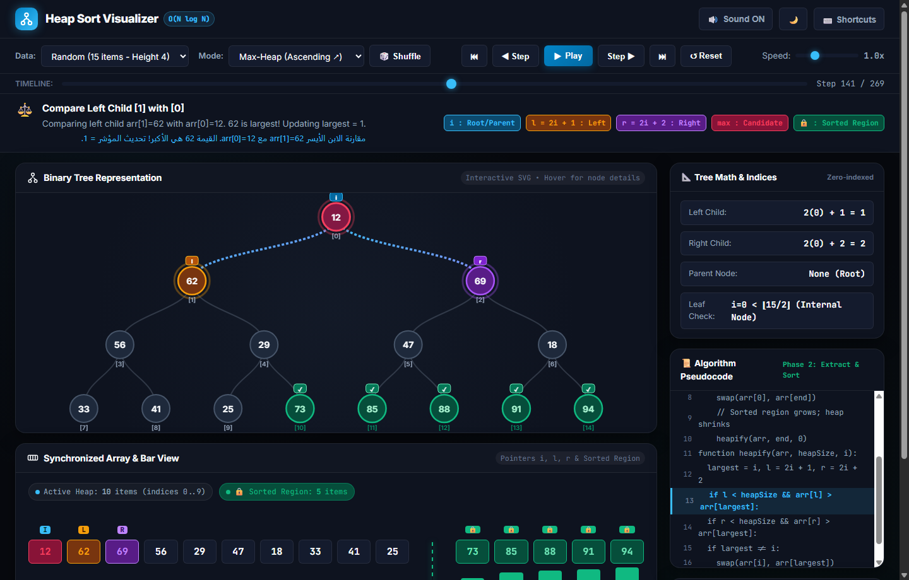
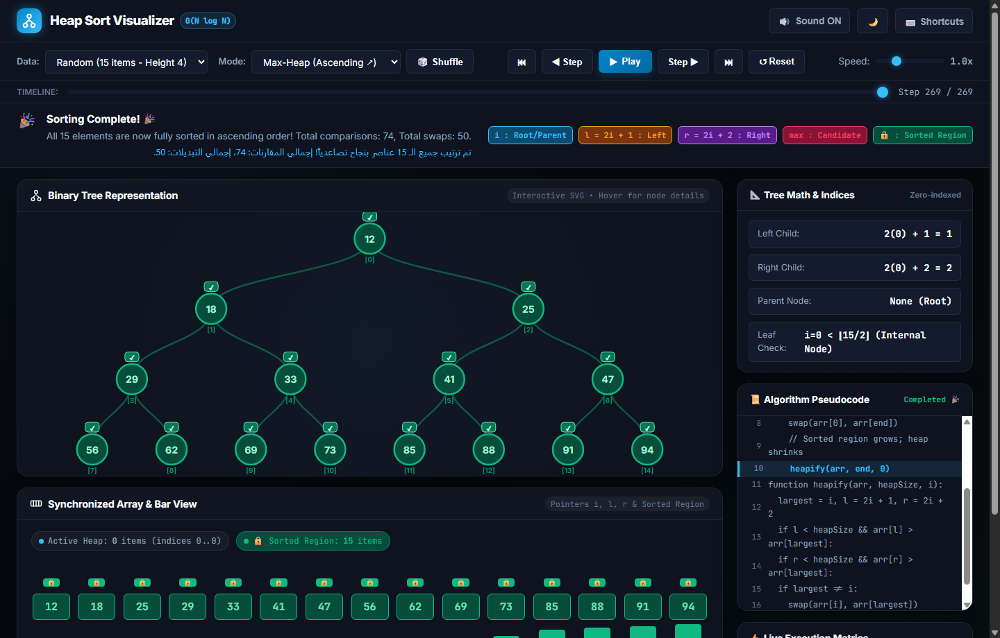
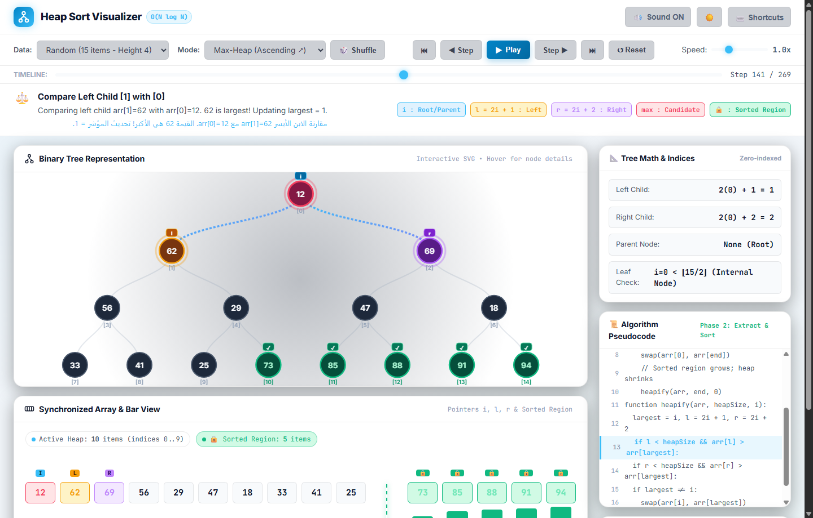
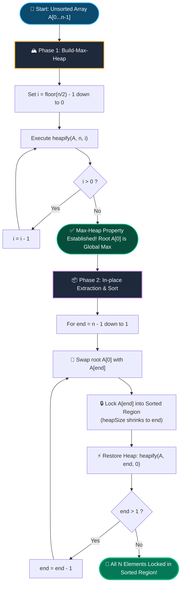
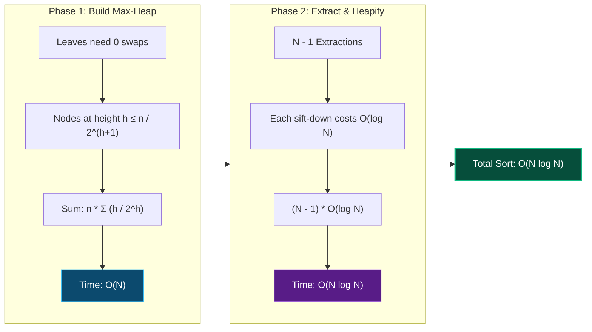

<div align="center">


<br/>

[](https://en.wikipedia.org/wiki/Heapsort)
[-10b981?style=for-the-badge&logo=speedtest&logoColor=white)](https://en.wikipedia.org/wiki/Heapsort#Analysis)
[%20Auxiliary-f59e0b?style=for-the-badge&logo=ram&logoColor=white)](https://en.wikipedia.org/wiki/Heapsort)
[](index.html)
[-0284c7?style=for-the-badge&logo=w3c&logoColor=white)](index.html)

<br/>

**A handcrafted, publication-grade interactive visualizer animating Heap Sort simultaneously as a Complete Binary Tree (SVG) and as a Synchronized Array (Flex/Bars), with micro-step pointer tracking for `i`, `l`, `r`, and the `Sorted Region`.**

*أداة تعليمية وتفاعلية متكاملة لمحاكاة خوارزمية ترتيب الـ Heap (Heap Sort) بصرياً كشجرة ثنائية ومصفوفة متزامنة مع تتبع دقيق للمؤشرات والمنطقة المرتبة ومؤثرات صوتية إجرائية.*

[Live Demo](#quick-start) • [Visual Architecture](#visual-architecture) • [Mathematical Foundations](#mathematical-foundations) • [Controls & Shortcuts](#keyboard-shortcuts)

</div>

---

## 📸 Visual Showcase & Interface Gallery

<div align="center">
  <h3>⚡ Active Sorting Phase (Pointers i, l, r & Sorted Region Active)</h3>
  
</div>

<br/>

<div align="center">
  <table width="100%">
    <tr>
      <td width="50%" align="center">
        <h4>🎉 Sorting Completed (All Locked in Emerald Suffix)</h4>
        
      </td>
      <td width="50%" align="center">
        <h4>☀️ Precision Light Mode Theme</h4>
        
      </td>
    </tr>
  </table>
</div>

---

## 🌟 Key Engineering & UX Highlights

Unlike generic algorithm visualizers with flat boilerplate designs, this project was crafted with **modern software design standards** (inspired by Linear, Raycast, and Stripe design systems):

- 🌳 **True Dual Synchronized View**:
  - **Dynamic SVG Tree**: Computes optimal $(x, y)$ coordinate distribution across all tree depths $d \in [0, \lfloor \log_2 n \rfloor]$. Renders anti-aliased cubic Bézier branches, responsive node radius, glowing pulse rings, and floating pointer badges.
  - **Array & Proportional Bars**: Displays array box cells with exact numerical values and subscript indices $0 \dots n-1$, accompanied by vertical relative-height bars for instant optical intuition.
- 🎯 **Strict Pointer Visual Tracking**:
  - **Cyan Badge `i`**: Current parent / root being evaluated in `heapify` or outer loop.
  - **Amber Badge `l`**: Left child computed via $2i + 1$.
  - **Purple Badge `r`**: Right child computed via $2i + 2$.
  - **Rose Badge `max` / `min`**: Current winning swap candidate among $\{i, l, r\}$.
- 🔒 **Explicit Sorted Region Partition**:
  - Once elements are extracted from the heap root to $A[\text{heapSize} - 1]$, they lock permanently into the **Sorted Region**.
  - Distinguishable by an animated turquoise dashed boundary line, emerald node glow, checkmark icons (`✓`), and lock badges (`🔒`).
- 🔊 **Procedural Web Audio API Engine**:
  - Real-time tone synthesis without audio assets: comparisons generate crisp sine beeps with pitch mapped to element value ($180\,\text{Hz} - 880\,\text{Hz}$), swaps trigger smooth frequency glissandos, and completion unleashes a celebratory pentatonic arpeggio.
- 📐 **Interactive Live Formula HUD**:
  - Click any node or cell to inspect its exact binary tree formulas:
    $$\text{left}(i) = 2i + 1 \quad \vert \quad \text{right}(i) = 2i + 2 \quad \vert \quad \text{parent}(i) = \left\lfloor \frac{i - 1}{2} \right\rfloor$$
- 📜 **Synchronized Pseudocode Engine**:
  - Live highlight tracking the active line of code across both Phase 1 (`Build-Heap`) and Phase 2 (`Extract & Sort`).
- ⏱️ **Bi-directional Time Travel & Scrubbing**:
  - Stepper engine records an immutable history trace. Users can scrub through the timeline, step backward, pause, and adjust playback speed ($0.25\times$ to $3.0\times$).
- 🌐 **Bilingual Pedagogical Narratives**:
  - Every micro-step includes concise English and native Arabic explanations explaining why a comparison succeeded or why a swap occurred.

---

## 🧠 Mathematical & Algorithmic Foundations

Heap Sort is an **in-place**, **comparison-based** sorting algorithm with guaranteed $O(N \log N)$ worst-case time complexity, combining the $O(N \log N)$ speed of Merge Sort with the $O(1)$ auxiliary space economy of Heaps.

### 1. Complete Binary Tree Array Mapping
A complete binary tree has all levels completely filled except possibly the lowest, which is filled from left to right. This enables storing the tree in a contiguous 1D array with zero pointer overhead:

| Relationship | Mathematical Formula | Zero-Indexed Formula | Condition |
| :--- | :--- | :--- | :--- |
| **Parent Node** | $\text{parent}(i)$ | $\lfloor (i - 1) / 2 \rfloor$ | $i > 0$ |
| **Left Child** | $\text{left}(i)$ | $2i + 1$ | $2i + 1 < \text{heapSize}$ |
| **Right Child** | $\text{right}(i)$ | $2i + 2$ | $2i + 2 < \text{heapSize}$ |
| **Leaf Nodes Boundary** | $\text{isLeaf}(i)$ | $i \ge \lfloor n / 2 \rfloor$ | Indices $\lfloor n/2 \rfloor \dots n-1$ are leaves |
| **Tree Height** | $H$ | $\lfloor \log_2 n \rfloor$ | Depth from root $0$ to furthest leaf |

```
Array Indices:     [ 0 ]         <-- Root (i = 0)
                  /     \
             [ 1 ]       [ 2 ]   <-- Level 1 (2^1 = 2 nodes)
             /   \       /   \
          [ 3 ] [ 4 ] [ 5 ] [ 6 ]<-- Level 2 (2^2 = 4 nodes)
```

---

### 2. Algorithmic Workflow & Lifecycle



---

### 3. Rigorous Complexity Breakdown



#### Why is `Build-Heap` $O(N)$ and not $O(N \log N)$?
A common misconception is that calling `heapify` ($O(\log N)$) on $N/2$ nodes costs $O(N \log N)$. In reality, nodes near the bottom have very short descent paths:
- There are at most $\lceil n / 2^{h+1} \rceil$ nodes at height $h$.
- The total cost is:
  $$\sum_{h=0}^{\lfloor \log_2 n \rfloor} \left\lceil \frac{n}{2^{h+1}} \right\rceil O(h) = O\left( n \sum_{h=0}^{\infty} \frac{h}{2^h} \right)$$
- Using the standard geometric progression identity $\sum_{h=0}^{\infty} \frac{h}{2^h} = 2$:
  $$O(n \cdot 2) = \mathbf{O(N)}$$

| Metric | Complexity | Explanation |
| :--- | :--- | :--- |
| **Best Case Time** | $\Omega(N \log N)$ or $\Omega(N)$ | $\Omega(N \log N)$ for distinct keys; $\Omega(N)$ if all keys identical. |
| **Average Case Time** | $\Theta(N \log N)$ | Uniform average comparison and swap count. |
| **Worst Case Time** | $O(N \log N)$ | Guaranteed upper bound regardless of initial order. |
| **Auxiliary Space** | $O(1)$ | Pure in-place sorting within the input buffer. |
| **Stability** | **Unstable** | Long-distance swaps between root and leaves can reorder identical keys. |

---

## ⌨️ Keyboard Shortcuts

| Shortcut Key | Action |
| :--- | :--- |
| <kbd>Space</kbd> | Toggle Play / Pause |
| <kbd>→</kbd> or <kbd>L</kbd> | Step Forward (1 atomic micro-step) |
| <kbd>←</kbd> or <kbd>J</kbd> | Step Backward (Undo last step) |
| <kbd>Home</kbd> | Jump to First Step (Initial Unsorted) |
| <kbd>End</kbd> | Jump to Last Step (Complete Sorted) |
| <kbd>R</kbd> | Reset to initial array state |
| <kbd>S</kbd> | Shuffle / Generate new random numbers |
| <kbd>M</kbd> | Toggle Web Audio procedural sound effects |
| <kbd>T</kbd> | Toggle Dark / Light theme |
| <kbd>?</kbd> | Open Keyboard Shortcuts Modal |
| <kbd>Esc</kbd> | Close any open modal dialog |

---

## 🗂️ Project Architecture & Structure

```
Project_3/
├── index.html              # Semantic responsive layout, accessibility & HUD panels
├── style.css               # Modern design system (glassmorphism, variables, dark/light)
├── js/
│   ├── heapSortEngine.js   # Deterministic step tracer & state machine (Max & Min Heap)
│   ├── treeRenderer.js     # Responsive SVG binary tree renderer with Bézier connectors
│   ├── arrayRenderer.js    # Synchronized array cells, proportional bars & divider
│   ├── soundEffects.js     # Procedural Web Audio API sound synthesizer
│   └── main.js             # Application coordinator, keyboard routing & HUD binding
├── assets/
│   ├── banner.svg          # Vector hero header banner
│   ├── favicon.svg         # High-resolution vector favicon
│   ├── preview.png         # Screenshot: Active sorting phase with pointers
│   ├── preview_complete.png# Screenshot: Fully sorted state in emerald
│   └── preview_light.png   # Screenshot: Light mode theme
└── README.md               # Comprehensive documentation & technical report
```

---

## 🚀 Quick Start Guide

This project is built using modern native Web Standards with **zero external dependencies** and **zero build steps**.

### Option 1: Direct Double-Click
Simply double-click `index.html` in your file explorer, or drag and drop it into any modern web browser (Google Chrome, Microsoft Edge, Mozilla Firefox, Safari).

### Option 2: Local HTTP Server (Optional)
If you prefer running via a local development server:
```bash
# Using Node's built-in npx
npx serve .

# Or using Python (if installed)
python -m http.server 8080
```
Then navigate to `http://localhost:8080` or `http://localhost:3000`.

---

## 🎓 Pedagogical Value & Classroom Use

This visualizer is specifically tailored for:
1. **Computer Science Undergraduates**: Clarifying the mental leap between linear array index math ($2i+1, 2i+2$) and hierarchical tree graphs.
2. **Algorithms Teaching Assistants & Professors**: Projecting step-by-step executions during lectures with full speed control, backward stepping, and custom array inputs.
3. **Coding Interview Candidates**: Deepening mechanical mastery of heap invariants, sift-down implementations, and priority queues.

<br/>

<div align="center">
  <sub>Crafted with passion for Data Structures &amp; Algorithms education.</sub>
</div>

