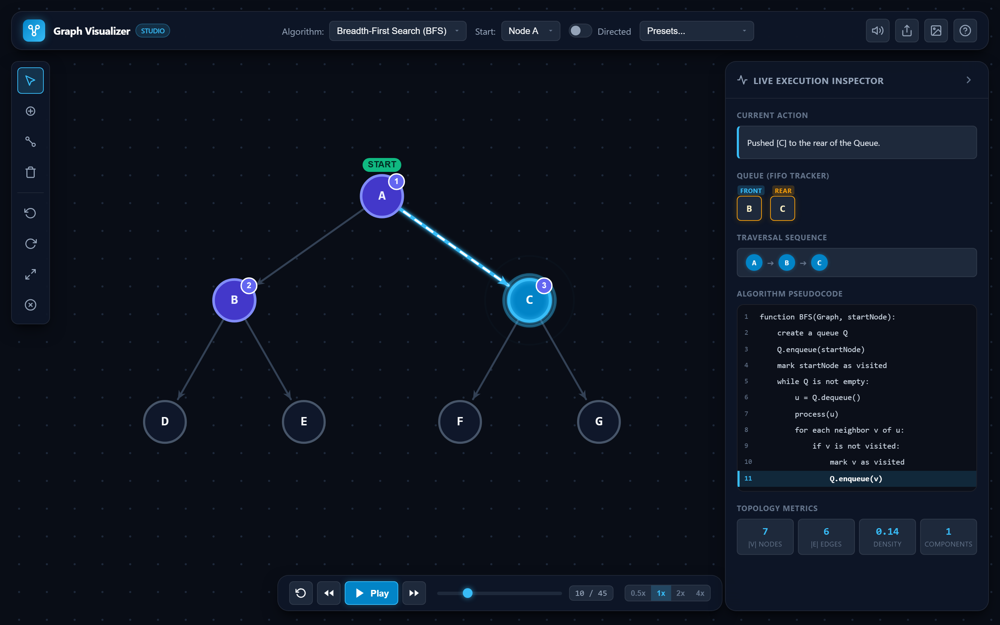
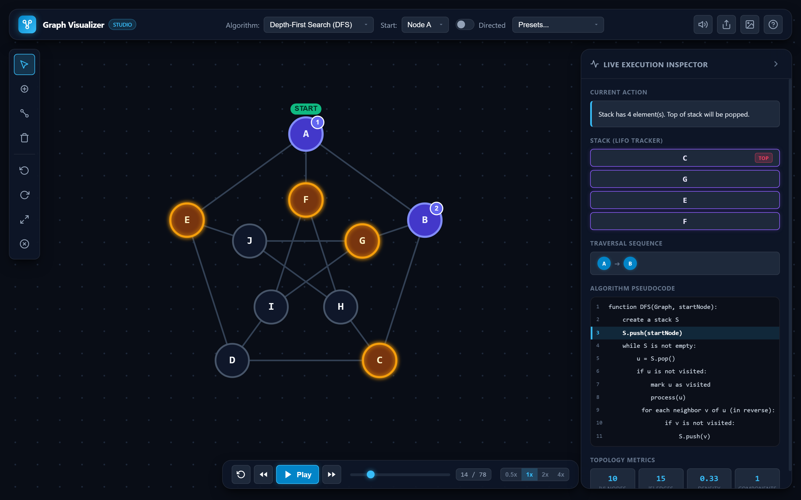
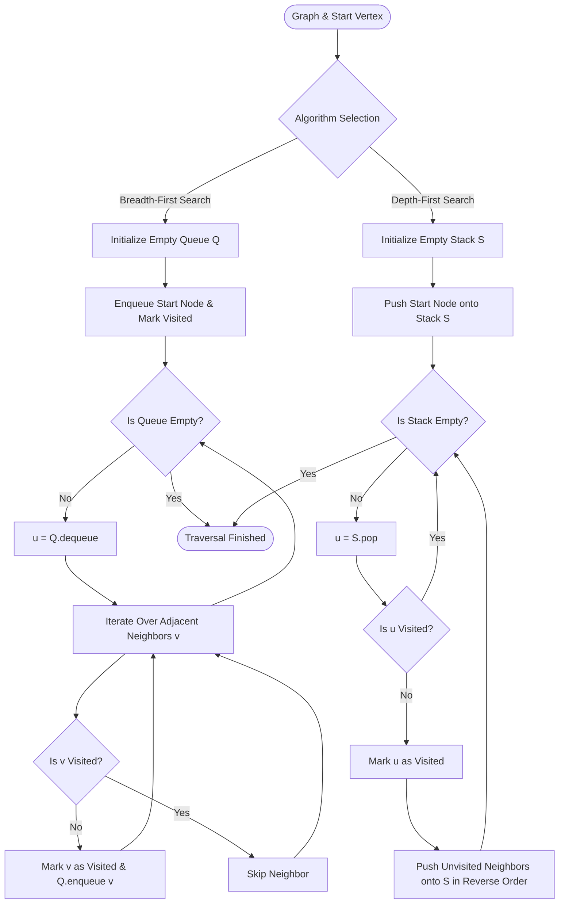
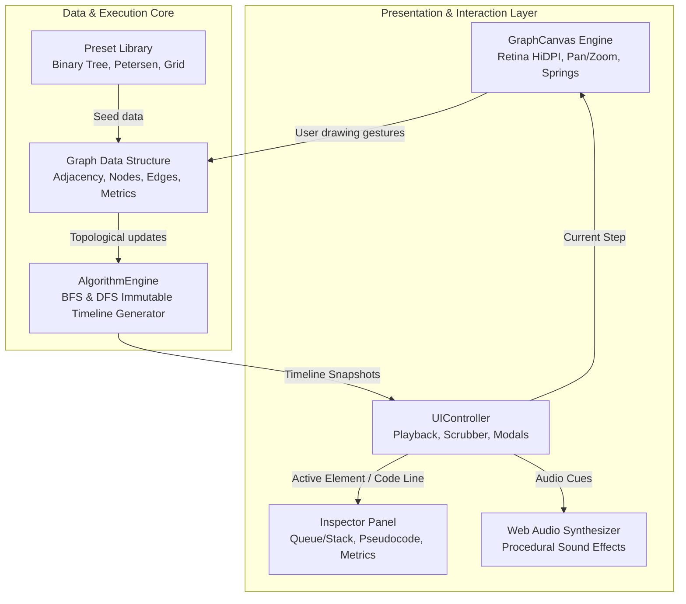

<div align="center">

# 🌐 Graph Visualizer Studio
### An Artisanal, Precision BFS & DFS Interactive Algorithm Studio

[](LICENSE)
[](index.html)
[-10B981?style=flat-square)](index.html)
[](js/audio.js)
[](js/canvas.js)

<p align="center">
  A bespoke, dark-mode graph exploration workbench built for computer science students and engineers.<br/>
  Draw arbitrary directed or undirected graphs, animate <b>Breadth-First Search (BFS)</b> and <b>Depth-First Search (DFS)</b> with live data structure tracking (Queue/Stack), synchronize pseudocode line-by-line, and scrub backwards and forwards in time.
</p>

---



</div>

---

## 🌟 Visual Showcase & Comparison

| 🌊 Breadth-First Search (BFS) | 🌲 Depth-First Search (DFS) |
| :---: | :---: |
|  |  |
| **FIFO Queue Inspection** &bull; Radial level-order wavefront traversal &bull; Shortest-path guarantee on unweighted graphs | **LIFO Stack Inspection** &bull; Deep branch plunge with backtrack history &bull; Petersen graph cycle discovery |

---

## ✨ Engineering & UX Highlights

Unlike cookie-cutter templates or generic visualizers, **Graph Visualizer Studio** is engineered with tactile developer-first ergonomics inspired by modern tools like Linear, Raycast, and Figma:

### 🎨 Freehand & Precision Graph Creation
- **Click-to-Spawn Nodes**: Click anywhere on the dot-matrix canvas in `Node Mode` to instantly create auto-labeled vertices ($A, B, C \dots Z, A_1 \dots$).
- **Elastic Rubberband Edges**: Drag from any source node to a target node to establish connections with sleek directional arrowheads.
- **Undirected & Directed Graph Modes**: Seamlessly toggle between symmetric undirected edges and directed vectors.
- **Retina HiDPI Canvas**: Crystal-clear vector rendering with automatic `window.devicePixelRatio` scaling.
- **Infinite Smooth Pan & Cursor-Centric Zoom**: Seamless navigation across large complex graphs via mouse wheel and spacebar-drag.
- **Undo / Redo Architecture**: Built-in 30-step state history (`Ctrl+Z` / `Ctrl+Y`) for confident editing.

### ⏱️ Deterministic Time-Travel Playback
- **Timeline-Driven State Machine**: Every algorithm execution is pre-compiled into an immutable step-by-step state timeline.
- **Bi-Directional Scrubbing**: Move forward (`→`) and step backwards in time (`←`) with instantaneous frame reconstruction.
- **Continuous Scrubber Bar**: Drag the timeline slider to immediately jump to any state of the traversal.
- **Variable Speed Regulator**: Fine-tune playback from ultra-slow inspection (`0.5x`) to rapid demonstration (`4x`).

### 🧩 Auxiliary Data Structure Inspector
- **BFS Live Queue (FIFO)**: Horizontal visual track animating items entering the `REAR` and dequeuing from the `FRONT`.
- **DFS Live Stack (LIFO)**: Vertical stack visualizer displaying items pushed onto and popped from the `TOP`.
- **Active State Highlights**: Nodes in the queue/stack glow in warm amber on the canvas, while the currently inspected vertex ripples in radiant electric cyan.

### 📜 Real-Time Pseudocode & Narrative Tracker
- **Line-by-Line Code Highlighting**: Synchronized pseudocode block highlights the exact instruction currently executing.
- **Live Action Narrative**: Human-readable step logs explaining *why* a node was dequeued, why an edge was inspected, or why a branch backtracked.
- **Traversal Sequence Breadcrumbs**: Dynamic pill sequence recording the exact discovery order ($A \rightarrow B \rightarrow C \dots$).

### 🔊 Procedural Web Audio Synthesizer
- Zero external MP3/WAV assets. 100% offline procedural audio built directly with the **Web Audio API**.
- Micro-tones for node placements, elastic connector swooshes, ascending pitch on node discoveries, distinct tones for enqueue vs. dequeue, and harmonic celebration chords on traversal completion. Fully toggleable (`M`).

### 💾 State Portability & HD Snapshot Export
- **JSON Import / Export**: Share and load complex graph configurations in standard JSON format.
- **HD PNG Snapshot Generator**: Export pixel-perfect high-resolution PNG renders directly from the canvas for presentations and academic reports.

---

## 🔬 Algorithmic Deep Dive



---

## 📊 Comprehensive Algorithm Comparison

| Attribute | Breadth-First Search (BFS) | Depth-First Search (DFS) |
| :--- | :--- | :--- |
| **Auxiliary Data Structure** | **FIFO Queue** (`enqueue` / `dequeue`) | **LIFO Stack** (`push` / `pop`) or Call Stack |
| **Exploration Strategy** | Level-by-level radial wavefront | Deep single-branch plunge before backtracking |
| **Time Complexity** | $\mathcal{O}(|V| + |E|)$ | $\mathcal{O}(|V| + |E|)$ |
| **Auxiliary Space Complexity** | $\mathcal{O}(|V|)$ (Queue width up to maximum breadth) | $\mathcal{O}(|V|)$ (Stack height up to maximum depth) |
| **Shortest Path (Unweighted)** | **Guaranteed** (finds path with minimum edges) | **Not guaranteed** (can find convoluted deep paths) |
| **Cycle Detection** | Using visited set / cross edges | Using back-edges in DFS tree |
| **Canonical Applications** | Shortest paths, peer-to-peer networks, GPS routing, Web crawlers | Topological sorting, maze solving, connected components, puzzle solving |

---

## 💻 Algorithmic Pseudocode

### Breadth-First Search (BFS)
```python
def BFS(graph, start_vertex):
    queue = []
    visited = set()
    
    queue.append(start_vertex)
    visited.add(start_vertex)
    
    while len(queue) > 0:
        current = queue.pop(0)  # FIFO Dequeue
        process(current)
        
        for neighbor in graph.get_neighbors(current):
            if neighbor not in visited:
                visited.add(neighbor)
                queue.append(neighbor)  # FIFO Enqueue
```

### Depth-First Search (DFS)
```python
def DFS(graph, start_vertex):
    stack = [start_vertex]
    visited = set()
    
    while len(stack) > 0:
        current = stack.pop()  # LIFO Pop
        
        if current not in visited:
            visited.add(current)
            process(current)
            
            # Push unvisited neighbors in reverse for alphabetical traversal
            for neighbor in reversed(graph.get_neighbors(current)):
                if neighbor not in visited:
                    stack.append(neighbor)  # LIFO Push
```

---

## ⌨️ Canvas Controls & Keyboard Shortcuts

| Shortcut | Action | Description |
| :--- | :--- | :--- |
| <kbd>Space</kbd> | **Play / Pause** | Toggle automated traversal playback |
| <kbd>→</kbd> | **Step Forward** | Advance traversal by exactly one state step |
| <kbd>←</kbd> | **Step Backward** | Rewind traversal by one state step |
| <kbd>R</kbd> | **Reset** | Return to step 0 of current traversal |
| <kbd>V</kbd> | **Select / Drag Mode** | Drag vertices around with dynamic edge recalculation |
| <kbd>N</kbd> | **Add Node Mode** | Click anywhere on canvas to instantiate a new vertex |
| <kbd>E</kbd> | **Connect Edge Mode** | Click source node and drag to destination to connect |
| <kbd>X</kbd> | **Erase Mode** | Click any node or edge to safely remove it |
| <kbd>F</kbd> | **Fit to View** | Automatically re-center and frame the graph in viewport |
| <kbd>M</kbd> | **Mute / Unmute Audio** | Toggle Web Audio API synthesizer |
| <kbd>Ctrl</kbd> + <kbd>Z</kbd> | **Undo** | Revert last graph creation or modification |
| <kbd>Ctrl</kbd> + <kbd>Y</kbd> | **Redo** | Redo previously reverted graph action |
| **Right-Click Node** | **Set Start Node** | Choose starting vertex for BFS or DFS |
| **Middle Click / Space+Drag** | **Pan Viewport** | Translate camera freely across the infinite canvas |
| **Mouse Wheel** | **Smooth Zoom** | Zoom in/out smoothly centered at mouse cursor |

---

## 📚 Built-in Preset Graph Library

For instant experimentation, Graph Visualizer Studio includes curated graph topologies:

1. **Balanced Binary Tree (Depth 3)**:
   - 7 nodes arranged in a clean binary hierarchy.
   - Highlights the fundamental contrast between **Level-Order traversal** (BFS: $A \rightarrow B, C \rightarrow D, E, F, G$) versus **Pre-Order depth plunge** (DFS: $A \rightarrow B \rightarrow D \rightarrow E \dots$).
2. **Petersen Graph (10 Nodes, 15 Edges)**:
   - The famous 3-regular cubic symmetric graph with an outer pentagon and inner star.
   - Demonstrates multi-cycle traversal, bridge evaluation, and backtracking.
3. **Cycle Network with Bridges**:
   - 6-node cycle with cross-chords demonstrating path bifurcation.
4. **3x3 Mesh Grid**:
   - Demonstrates Manhattan wave expansion in BFS versus snake exploration in DFS.

---

## 🏛️ System Architecture



---

## 🚀 Quick Start & Setup

The project is built entirely with **standard, modern web technologies (HTML5 + CSS3 + Vanilla ES6 JavaScript)** with **zero dependencies or build steps**.

### Option 1: Direct File Open
Double-click `index.html` in your file explorer or open it in any modern browser (Chrome, Edge, Firefox, Safari).

### Option 2: Local Development Server
If you prefer running a local static server:

```bash
# Using Node.js (npx)
npx serve .

# Or using Python 3
python -m http.server 8000
```
Then navigate to `http://localhost:3000` (or `http://localhost:8000`).

---

## 📁 Repository Structure

```text
Project_4/
├── index.html              # Studio HTML5 layout & floating HUD structures
├── css/
│   └── style.css           # Bespoke dark-mode design system & animations
├── js/
│   ├── audio.js            # Procedural Web Audio API sound engine
│   ├── graph.js            # Graph data structure, adjacency, metrics, undo/redo
│   ├── algorithms.js       # BFS & DFS timeline snapshot generators
│   ├── presets.js          # Curated graph topology datasets
│   ├── canvas.js           # HiDPI Canvas rendering, pan/zoom, drawing interactions
│   ├── ui.js               # Playback controller, queue/stack DOM, pseudocode syncing
│   └── app.js              # Application bootstrap & initialization
├── assets/
│   ├── preview.png         # High-resolution screenshot of BFS traversal
│   └── dfs-preview.png     # High-resolution screenshot of DFS on Petersen graph
├── scripts/
│   └── capture.js          # Headless Chrome CDP screenshot capture automation
└── README.md               # Comprehensive documentation & technical guide
```

---

## 📄 License
This project is open-source and licensed under the [MIT License](LICENSE).
Feel free to use it for academic coursework, graph theory presentations, or personal projects!

